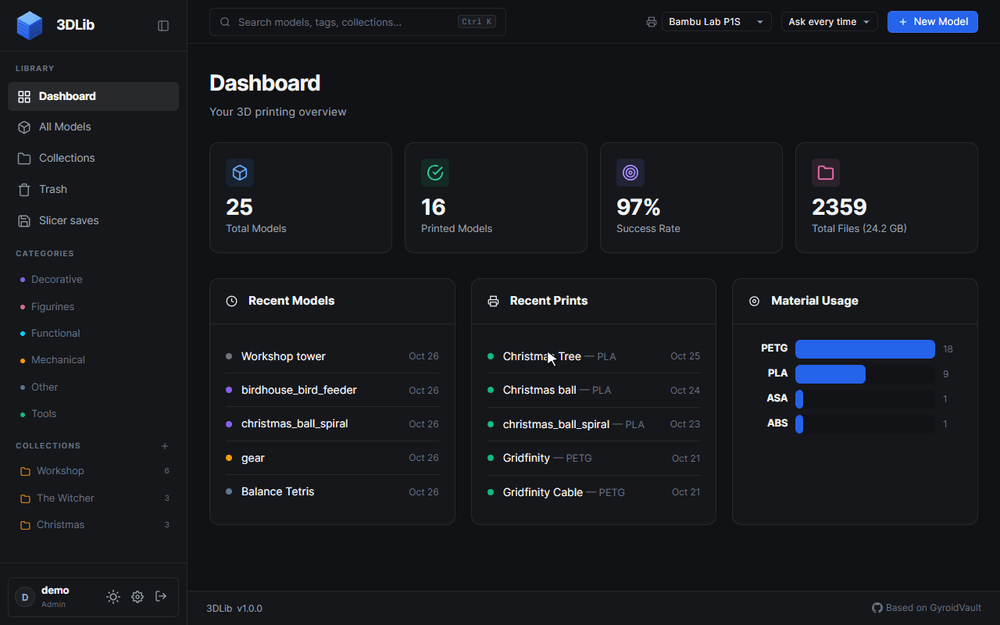
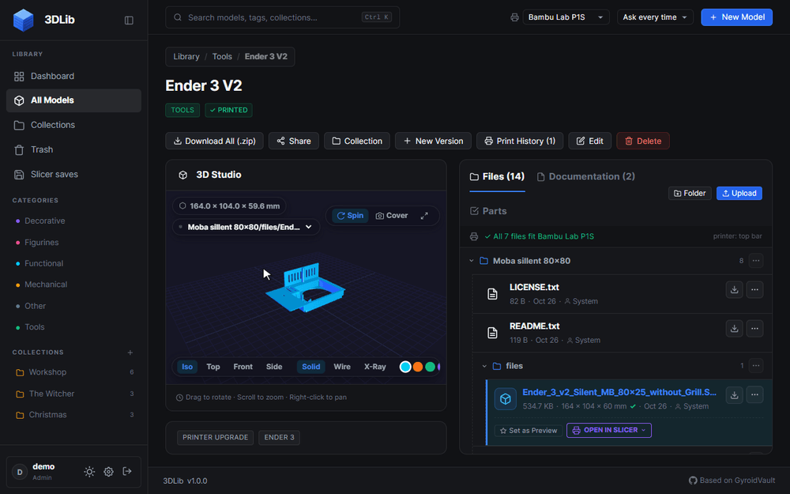
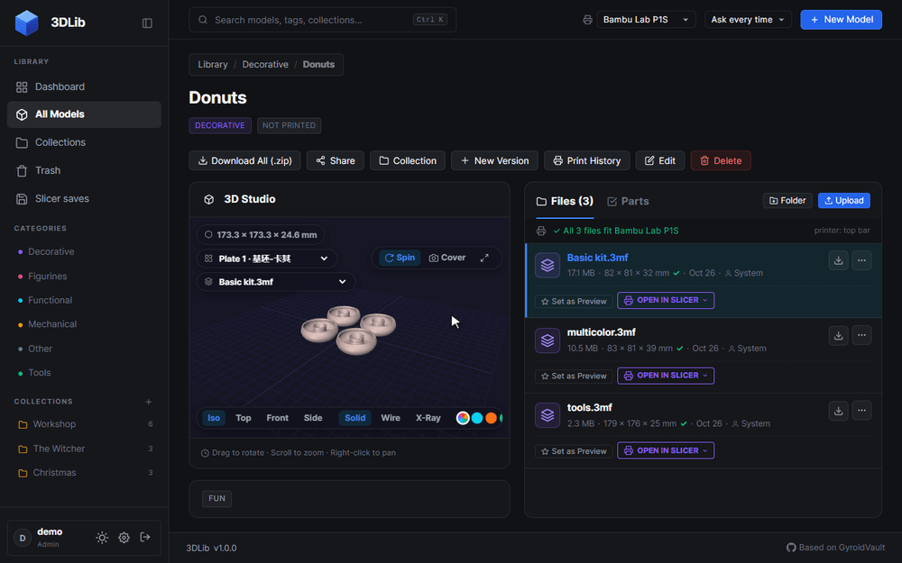
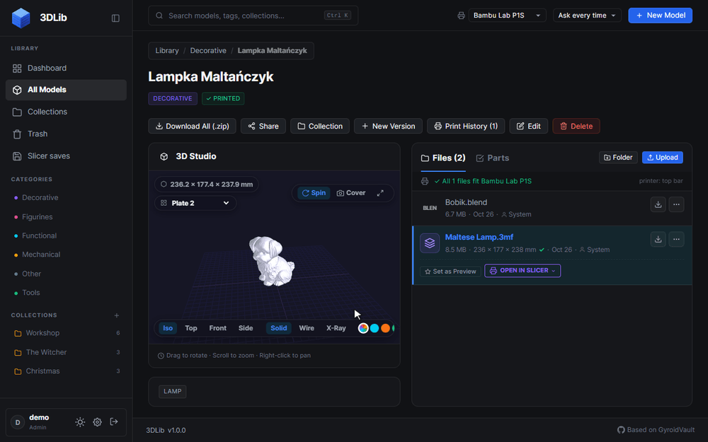
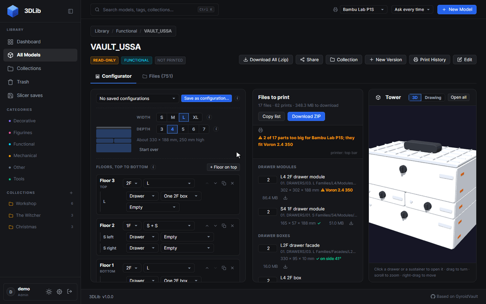
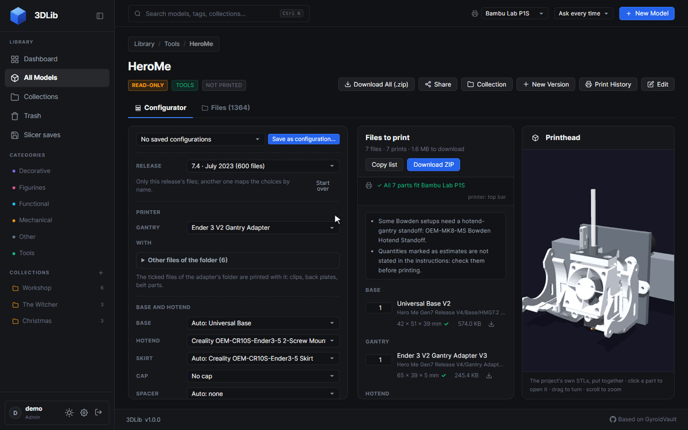

<p align="center"></p>

<h1 align="center">3DLib</h1>

<p align="center">
  A self-hosted library for the 3D printing files you already keep on your NAS.<br>
  3D previews, a slicer round trip with file history, print tracking, and configurators for two
  modular kits: USSA VAULT and Hero Me Gen7.
</p>

<p align="center">
  <a href="LICENSE"></a>
  
</p>



3DLib indexes the STL, 3MF, STEP, OBJ and G-code files on a network share and gives every project
a page with a 3D preview, its files, its print history and its parts list. The files stay where
they are, named the way you named them: the share is the source of truth, and the app works on it
directly.

3DLib started as a fork of [GyroidVault](https://github.com/TeeCodeDev/GyroidVault) by TeeCodeDev
and is licensed, like GyroidVault, under the AGPL-3.0.

## How it works

You point 3DLib at one folder, usually a share on a NAS mounted into the container.

- **Every entry in the library root is a project.** A loose model file (`Benchy.3mf`) is one
  project; same-named images and documents next to it join it (`Benchy.jpg`). A folder is one
  project with its whole subfolder tree. Every file in it is indexed; the ones 3DLib cannot preview
  are still listed.
- **A scan reads the folder into a database** (SQLite, one file in the data directory). It runs
  when you click **Scan Library** and on a schedule (every 24 hours by default), and it never
  moves or renames anything. An hourly sync drops the files that are gone from disk, but never
  while the share is missing or empty, so an unmounted NAS cannot wipe the index.
- **The server streams, the browser renders.** The server serves the files, makes WebP thumbnails
  and measures the size of every 3D file in a worker thread. The browser renders the previews with
  three.js.
- **What you change in the app happens on the share.** Renaming, moving and deleting files and
  folders works on the disk. Deleting goes to the Trash first; files are purged after a retention
  period you choose. Projects can be marked read-only, and then nothing in the app touches them.

## Features

### A project is a folder, with all of it



The model page shows the project's whole subfolder tree. Click a file to preview it:

- STL, 3MF, STEP and OBJ in the 3D studio (iso / top / front / side views, solid, wireframe or
  X-ray, colour swatches, turntable spin, fullscreen);
- G-code as toolpaths;
- images with zoom and pan, videos, PDFs in the browser's viewer, TXT / Markdown / SCAD as text;
- the project's README as its description.

The "..." menu of a file or folder renames, moves or deletes it, and **Download All** streams the
whole project as a ZIP (ZIP64 past 4 GB) without building it in memory first.

### Bambu Studio and OrcaSlicer projects, plate by plate



3MF projects from Bambu Studio and OrcaSlicer open one build plate at a time, with the plate names
from the slicer. Every object and part gets its filament colour, and painted triangles keep their
colours too.

Each 3D file is measured, and the **printer fit check** compares it with the printer chosen in the
top bar: "All 7 files fit Bambu Lab P1S", or "2 of 17 parts too big for Bambu Lab P1S; they fit
Voron 2.4 350". The list of printers is editable.

### Slicer round trip and file history



1. **Open in slicer** sends the file to OrcaSlicer, Bambu Studio, Elegoo Slicer or Cura. The file
   name in the link carries the file's token.
2. You save the project in the slicer, into `.slicer-saves` in the library share (set it once as
   the slicer's save folder).
3. 3DLib checks that folder every 30 seconds. The token tells it which library file the save
   belongs to, whatever the slicer named it; a save that matches nothing waits on the **Slicer
   saves** page.
4. A few quiet minutes after the last save the library file is replaced. What it held before goes
   to the file's **History**: preview, download, restore, delete.

- An STL saved as a 3MF project lands next to it as `<name>.3mf` and becomes the main file.
- In a read-only project a save never replaces the original. It becomes a version of its own, with
  the slicer settings it was saved with and what changed from the version before.

### Kit configurators

Some projects are not a model but a system of hundreds of parts. For now 3DLib has a configurator
for two of them only: **USSA VAULT** and **Hero Me Gen7**. It recognises their archives in your
library by the file names; every other project opens as a regular model page. 3DLib ships none of
their files: you need your own copy of the archive, which becomes read-only in the app.

#### USSA VAULT



Pick the width, the depth and the floors of a VAULT storage tower (drawers or sustainers, boxes,
interiors, roof, base, backbone, pegboard). The tower is drawn in 3D as you go (click a drawer to
open it), and the drawing gives every height. The parts list says which files of the archive to
print and how many times, plus the hardware, and **Download ZIP** packs exactly those files.


A saved configuration becomes a model of its own: search it, tag it, add it to a collection,
download its ZIP. Count the prints of each part as you go, or mark everything printed; the
progress shows on its card in the model grid.

#### Hero Me Gen7



The Hero Me Gen7 printhead platform by MediaMan3D: pick a release (7.0 to 7.4, Magnet Edition), the gantry adapter for your printer,
the hotend mount, part cooling ducts, ABL sensor, extruder mount, cable tower and ADXL345 mount.
The printhead is put together in 3D from the project's own STL files, each part on the mounting
holes of the base. Hover a part to find it in the list, click it to open it.

Any other project can have a parts list as well (the **Parts** tab): how many prints of each file,
the hardware to buy, notes, and the same print counters.

### And also

- Collections, tags and categories; filters by format, size and print status
- Search that ignores case and accents ("lozyska" finds "Łożyska"); names sorted the way people
  read them, accented letters and numbers included
- Print history with materials, success rate and a dashboard
- Password-protected models: they ask for the password every time they are opened, and their
  covers stay blurred in lists
- Trash for models, files and folders, purged after a retention period
- A Folder Explorer view of the share, duplicate finder
- Share links, users with roles (admin, user, viewer), invitations, API keys
- Send G-code to a Klipper printer (Moonraker)
- Light and dark theme

## Running with Docker

```yaml
services:
  3dlib:
    image: ghcr.io/jarek-pieprzak/3dlib:latest
    container_name: 3dlib
    ports:
      - "3457:3000"
    volumes:
      - ./data:/app/data
      - /path/to/your/3d-models:/library
    environment:
      - NODE_ENV=production
      - PORT=3000
      - LIBRARY_PATH=/library
    restart: unless-stopped
```

The library mount must be writable: 3DLib renames, moves and purges files there.

The first account registered on a new installation becomes the administrator. Then open **All
Models** and click **Scan Library**.

Every push to `main` runs the tests and publishes the image (`.github/workflows/custom-image.yml`).

## Running without Docker

Node.js 22:

```bash
npm ci
npm start
```

Environment variables: `PORT` (default 3000), `DATA_DIR` (database, uploads and caches; default
`./data`), `LIBRARY_PATH` (default `<DATA_DIR>/library`), `NODE_ENV`, `JWT_SECRET` (optional; a
secret is generated and stored in the database otherwise).

The database is `<DATA_DIR>/3dlib.db`.

## Development

```bash
npm run dev   # server with --watch
npm test      # syntax and scope checks, UI templates, end-to-end API tests
```

The frontend is plain JavaScript without a build step: `public/js/app.js` (router and handlers),
`public/js/components.js` (HTML templates), `public/js/viewer.js` (three.js viewer) and
`public/js/kits/` (the configurators). The server is Node.js and Express with sql.js
(`server/`).

## License and credits

3DLib is licensed under the **GNU Affero General Public License v3.0**; see [LICENSE](LICENSE).
It is based on [GyroidVault](https://github.com/TeeCodeDev/GyroidVault) by TeeCodeDev.

USSA VAULT and Hero Me Gen7 belong to their designers. The models in the recordings above come
from a private library and belong to their designers; none of them is part of this repository.
