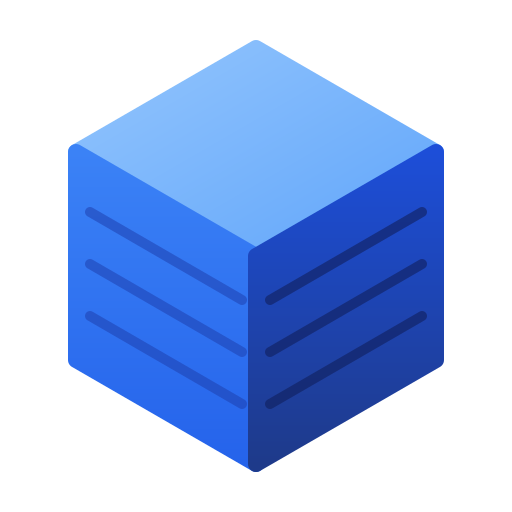

<p align="center"></p>

# 3DLib

[](LICENSE)

**3DLib** is a self-hosted library of 3D printing models. It indexes the STL, 3MF, STEP, OBJ and
G-code files you already keep on a NAS, shows them with a 3D preview, and keeps the slicer round
trip, print history and file versions next to them. The files on disk stay where they are and how
you named them.

3DLib started as a fork of [GyroidVault](https://github.com/TeeCodeDev/GyroidVault) by TeeCodeDev
and is licensed, like GyroidVault, under the AGPL-3.0.

## Features

- **Library from your folders:** every file or folder in the library root is one project; folders
  keep their whole subfolder tree. Files that disappear from disk are purged after a scan.
- **3D preview:** STL, 3MF, STEP and OBJ in a three.js viewer, G-code toolpaths, images, PDFs,
  videos and text files. 3MF projects from Bambu Studio and OrcaSlicer show their build plates and
  filament colours, painted triangles included.
- **Slicer round trip:** "Open in slicer" links for Bambu Studio, OrcaSlicer, PrusaSlicer and others.
  Projects saved back from the slicer replace the library file, and the old content goes to the
  file's history (preview, restore).
- **Trash:** deleting only marks models and files; they are purged from disk after a retention period.
- **File operations:** rename, move and delete files and folders from the model page.
- **Password-protected models:** marked models ask for a password every time they are opened.
- **Printer fit check:** sizes of the 3D files against your printers' build volumes.
- **Kit configurator:** the USSA VAULT archive opens in a configurator that builds the parts list
  and downloads the files to print as a ZIP.
- **Streamed ZIP downloads** of models, collections and selections, ZIP64 past 4 GB.
- Tags, categories, collections, print history, share links, users and roles.

## Running with Docker

```yaml
services:
  3dlib:
    image: ghcr.io/jarek-pieprzak/3dlib:latest
    container_name: 3dlib
    ports:
      - "3457:3000"
    volumes:
      - ./data:/app/data
      - /path/to/your/3d-models:/library
    environment:
      - NODE_ENV=production
      - PORT=3000
      - LIBRARY_PATH=/library
    restart: unless-stopped
```

The library mount must be writable: 3DLib renames, moves and purges files there.

Every push to `main` runs the tests and publishes the image (`.github/workflows/custom-image.yml`).

The first account registered on a new installation becomes the administrator.

## Running without Docker

Node.js 22:

```bash
npm ci
npm start
```

Environment variables: `PORT` (default 3000), `DATA_DIR` (database, uploads and caches; default
`./data`), `LIBRARY_PATH` (default `<DATA_DIR>/library`), `NODE_ENV`, `JWT_SECRET` (optional; a
secret is generated and stored in the database otherwise).

The database is `<DATA_DIR>/3dlib.db`.

## Development

```bash
npm run dev   # server with --watch
npm test      # syntax and scope checks, UI templates, end-to-end API tests
```

## License

3DLib is licensed under the **GNU Affero General Public License v3.0**; see [LICENSE](LICENSE).
It is based on [GyroidVault](https://github.com/TeeCodeDev/GyroidVault) by TeeCodeDev.
